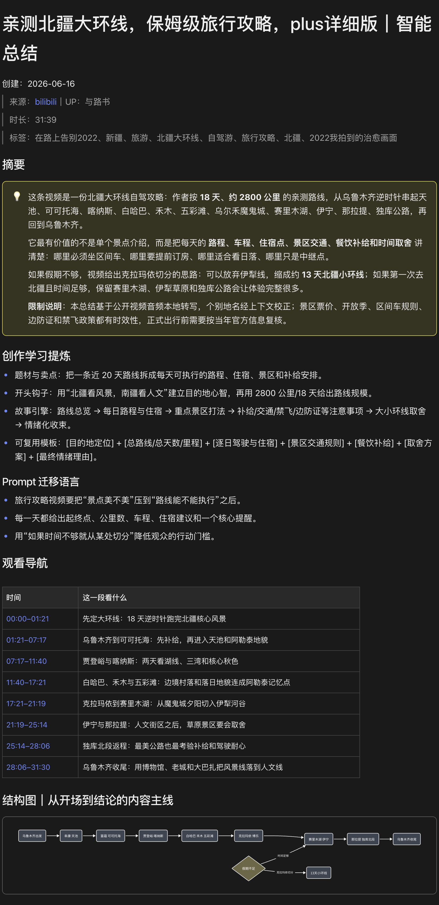
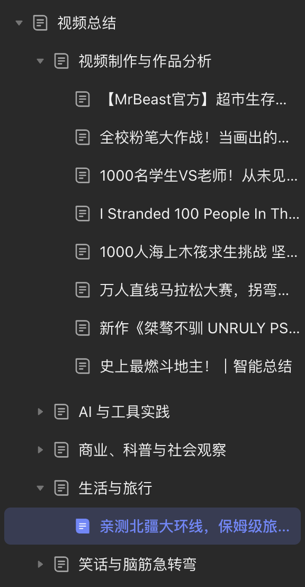

# video-summary

**把一条视频变成一篇能回看、能查证、能归档的笔记。**

给 Codex 或 Claude Code 一个视频链接，它会转写口播、挑出关键画面、判断这是什么类型的视频，再写出一篇带时间导航的总结：直接回在对话里，存成本地文件，或者写进你自己的飞书知识库并自动归类。

Turn any public video into an evidence-backed, timestamped note — in chat, as a local file, or filed into your own Feishu/Lark Wiki.

[看云狸Jin 的 78 秒演示（B 站）](https://www.bilibili.com/video/BV1A7sb6DEpq/)

<p align="center"></p>

## 你会得到什么

- **摘要**：一段话说清这条视频讲了什么、结论是什么。
- **时间导航**：按内容分节，每节标起止时间，点回原片就能对上。
- **按类型提炼**：科普讲知识链，教程讲步骤，访谈讲观点，评测讲结论和依据；不同类型用不同的写法。
- **关键画面**：从视频里挑出真正有信息的帧，配在对应章节。
- **一个会长大的知识库**（飞书模式）：每篇总结按主题归进你已有的分类，越用越像你自己的资料库。

<p align="center"></p>

写完之后它会回读一遍，核对时间点、数字和专业术语，而不是写完就交。

## 快速开始（不用飞书）

需要：[uv](https://docs.astral.sh/uv/getting-started/installation/)、ffmpeg（含 ffprobe），以及一个能正常使用的 Codex 或 Claude Code。以下命令在 macOS 上实测；Linux 和 Windows 尚未验证。

**1. 下载并检查工具**

```bash
git clone https://github.com/JinUnique/video-summary.git
cd video-summary
uv --version
ffmpeg -version
ffprobe -version
```

**2. 建独立环境**（首次转写会下载语音识别模型，需要能访问 Python 包源和 Hugging Face）

```bash
uv venv --no-config --python 3.12 .venv
uv pip install --no-config --python .venv/bin/python -r requirements.txt
```

**3. 把技能装进你的工作目录**（选你用的助手，两条都跑也可以；不改全局配置）

```bash
.venv/bin/python runtime/scripts/install_skill.py --assistant codex --project workspace
.venv/bin/python runtime/scripts/install_skill.py --assistant claude --project workspace
```

Codex 装到 `workspace/.agents/skills/video-summary/`，Claude Code 装到 `workspace/.claude/skills/video-summary/`。之后在 `workspace` 里新开助手会话即可使用。

**4. 准备视频素材**（示例是一条约 7 分钟的公开科普视频，换成你自己的 BV 号即可）

```bash
.venv/bin/python runtime/scripts/prepare_video.py BV1a3W76wETa --run-dir runs/demo --model base
```

看到 `evidence_ready`，说明转写、媒体和初始抽帧都已就绪。这一步还没有写总结。中途失败的话，重跑同一条命令会复用已完成的部分。

**5. 让助手写总结**

在 `workspace` 的助手会话里说：

> 用 video-summary 总结 ../runs/demo 这条视频，写到 ../runs/demo/doc/summary.md，写完回读核对。

只想在对话里看结果，就说“在对话里总结，不写文件”。写成文件的，可以再跑一次检查：

```bash
.venv/bin/python runtime/scripts/validate_local_summary.py --run-dir runs/demo
```

这条检查只核对文件、来源、时间范围和证据结构；内容准不准，仍要靠助手对照原片核查。想先看看结果长什么样：[本地输出样例](examples/public-video-summary.md)。

## 存进你的飞书知识库（可选）

先跑通上面的流程，再做这三步：

1. 按 [lark-cli 官方说明](https://github.com/larksuite/cli) 安装 CLI，用你自己的飞书应用完成授权，确认对目标知识库有读写权限。
2. 复制配置示例，填入你的知识库空间 ID 和父节点：

   ```bash
   cp config.example.json config.json
   ```

3. 跑一次只读预检：

   ```bash
   .venv/bin/python runtime/scripts/video_summary_preflight.py --entry terminal --delivery feishu --config config.json --require-asr --live-feishu-read --output runs/demo/metadata/preflight_feishu.json
   ```

预检通过后，对助手说“把这条总结写进 config.json 配置的知识库，按现有分类放，写完回读”。详细流程见 [飞书交付](references/feishu-delivery.md)。配置没填时预检会失败，这是预期行为；不选飞书模式时，不会读取配置，也不会调用 lark-cli。

## 它是怎么工作的


- **先拿证据，再动笔。** 媒体、转写和画面都先在本机准备好，助手根据这些证据写作，而不是只看标题和简介。
- **先分类型，再提炼。** 科普、教程、新闻、访谈、影视、AI 创作、评测、旅行各有提炼重点；笑话和脑筋急转弯走问答格式。
- **画面按内容挑。** 脚本先等间隔抽帧，助手读完转写后再按章节换成真正有信息的画面。
- **写完必回读。** 文件或飞书文档写完重新打开核对，有问题当场改。

脚本本身不调用任何付费大模型，也不会自动发布任何内容；理解和写作都由你自己的 AI 助手完成。

## 依赖与限制

| 项目 | 说明 |
|---|---|
| Codex / Claude Code | 自备账号和模型；这是给 AI 助手用的技能，不是一个现成的总结网站 |
| Python 3.10–3.12 | 依赖装在独立 venv：faster-whisper、PyAV、yt-dlp、PyYAML |
| ffmpeg / ffprobe | 媒体检查、转音频和抽帧，需单独安装 |
| B 站 | 优先走公开接口；支持 BV 号、视频链接、b23 短链；多 P 视频默认第 1 P，可指定分 P |
| 抖音等其他站点 | 有通用流程，依赖 yt-dlp 和站点当时的限制，尚未实测 |
| lark-cli | 只有飞书模式需要 |
| OCR / 图片理解 | 可选；无口播、靠字幕卡或幻灯片的视频可能需要 |

付费、会员、私有和受版权保护加密的内容不在支持范围内，也不会绕过访问限制。地域限制、风控、失效链接、直播和站点接口变化都可能导致失败。语音识别会有同音字和专业词错误，覆盖检查不保证每个字都识别正确。

## 隐私

- 默认不用 cookie。如果你另有授权流程，cookie 只放在仓库之外的本地位置，不贴进对话、不写进日志、不进 Git。
- 音视频、转写和关键帧都在本机处理。助手读到的文字和图片会不会发给它的模型服务，取决于你用的助手和它的设置。
- 飞书模式会把你选的总结和图片上传到你自己的飞书。
- `runs/`、`config.json`、虚拟环境和 cookie 文件默认被 Git 忽略；提交前仍请自己检查一遍。

请只处理你有权访问和使用的内容。

## 许可证

[MIT License](LICENSE)
